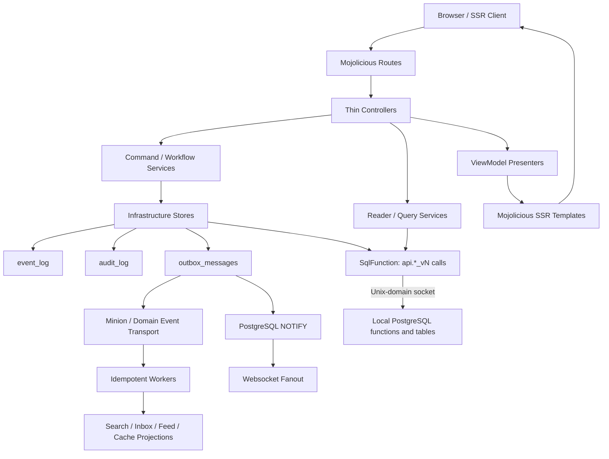

# Good Phorum Architecture

Good Phorum is a modular Mojolicious application. It renders pages on the server,
keeps canonical data in PostgreSQL and delivers durable events through an outbox.

## Architecture Audit

The current boundaries are enforced by `script/architecture-check` and the
integration suite:

- `GPForum.pm` composes bootstrap modules. Controllers adapt HTTP requests;
  services own workflows, readers and writes.
- `GPForum::Infrastructure::SqlFunction` calls versioned PostgreSQL functions
  ([ADR 0126](docs/adr/0126-sql-lives-in-postgresql-functions.md)). SQL lives
  in migrations; controllers and templates cannot reach resultsets.
- Reader services supply presenter view models. Shared SSR components handle
  translation, CSRF fields and semantic landmarks.
- Event, audit and outbox records commit with the write. Workers consume the
  durable event envelope.
- Internal module dependency cycles are rejected.

The [quality record](docs/QUALITY_PROGRAM.md) preserves dated audits and
follow-up evidence. The sections below describe the current implementation.

## Layer Map

Five layers, listed from the top. A module may depend on its own layer and the
layers below it, never on one above ([ADR 0107](docs/adr/0107-layers-are-the-namespaces-that-exist.md)).
`GPForum::Application::LayerMap` declares them and `t/192-layering.t` checks
every module in `lib/` against the declaration; `script/architecture-check`
runs the same test.

| Layer | Namespaces | Holds |
| --- | --- | --- |
| composition | the `GPForum` class, `Bootstrap`, `CLI`, `Application` | wiring the others together |
| adapter | `Controller`, `Command`, `Worker`, `Benchmark` | the ways in: HTTP, the command line, jobs |
| presentation | `Web`, `ViewModel`, `View`, `Theme`, `Security`, `I18N` | turning service results into pages and headers |
| service | `Service` | the application: rules, workflows, readers, stores |
| foundation | `Base`, `X`, `Config`, `Log`, `Runtime`, `OS`, `Domain`, `Jobs`, `Schema`, `Migration`, `Infrastructure` | configuration, persistence, cross-cutting contracts |

A new top-level namespace must be assigned a layer before the check passes.
Services call PostgreSQL functions directly, as specified in ADR 0107.

## Data Access

**Local processes reach PostgreSQL over Unix-domain sockets.** This includes
web requests, workers, command-line tools and `LISTEN` connections. The default
DSN is `dbi:Pg:dbname=gpforum`. Debian/Ubuntu commonly use
`host=/var/run/postgresql`; Homebrew and FreeBSD normally use `/tmp`.
A hostname or IP explicitly selects TCP for a remote database.
See [ADR 0137](docs/adr/0137-the-forum-reaches-postgresql-and-its-proxy-over-unix-sockets.md)
and [socket configuration](docs/DEPLOYMENT.md#unix-socket-mode).

Application reads and writes call `api.<name>_v<N>` functions. Migrations install
the SQL; the [current baseline](migrations/README.md) defines the API in
`2012_api_core.sql` through `2025_api_entry_points.sql`. A changed contract gets
a new version. `GPForum::Infrastructure::SqlFunctionCatalogue` declares names
and types; integration tests compare it with `pg_proc`. A
[restricted runtime login](docs/ops/sql-api-role.md) can enforce API-only access.

`GPForum::Schema` owns native Mojo::Pg connection and transaction storage
([ADR 0174](docs/adr/0174-mojo-pg-is-the-runtime-stored-function-transport.md)).
It exposes no ORM resultsets. DBIx::Class, historical models and comparison
profilers remain in maintainer fixtures under `t/lib` and develop dependencies.
Connection settings, notifications and schema administration belong to
infrastructure.

## Flow

## Current Decisions

- Durable events use `GPForum::Domain::EventEnvelope`.
- Forum, identity, moderation, privacy, export, attachment, admin role, mention fanout and rate-limit writes use `GPForum::Infrastructure::EventRecorder` for event/outbox/audit coordination. Canonical audit hashing lives in `GPForum::Infrastructure::AuditRecord`.
- Browser headers use `GPForum::Security::BrowserHeaders`.
- Repeated web error hashes use `GPForum::Web::ErrorPayload`.
- Health and realtime transport messages use dedicated `GPForum::Web::*Payload`
  modules so technical JSON contracts stay out of controllers.
- Realtime subscriptions use strict policy-backed authorization and
  PostgreSQL LISTEN/NOTIFY for multi-process enhancement fanout.
- Metrics, robots, sitemap, and Atom feed payload composition also lives in
  dedicated `GPForum::Web::*Payload` modules; service builders still own
  crawler/feed document encoding.
- SSR raw HTML pass-through uses `GPForum::Web::RenderPolicy`.
- Theme metadata and supported token contracts use `GPForum::Theme::Registry`;
  SSR theme selection is validated before it reaches HTML attributes.

## Roadmap

1. Keep new service writes behind `Infrastructure::EventRecorder`; direct `EventLog`, `OutboxMessage`, and `AuditLog` writes should remain confined to infrastructure.
2. Extract common controller response/error/auth helpers into `Web::*`.
3. The query-plan gate explains the statements inside the hot functions (ADR 0126, section 9); a new hot read joins `GPForum::Benchmark::QueryPlanEndpoints`.
4. Add command handler interfaces around moderation, privacy, attachment, and identity writes.
5. Normalize Minion job payloads through `Jobs::*`.
6. Add i18n namespace validation and catalog extraction reporting.
7. Maintain stored-function-only runtime access through Mojo::Pg (ADR 0174).
