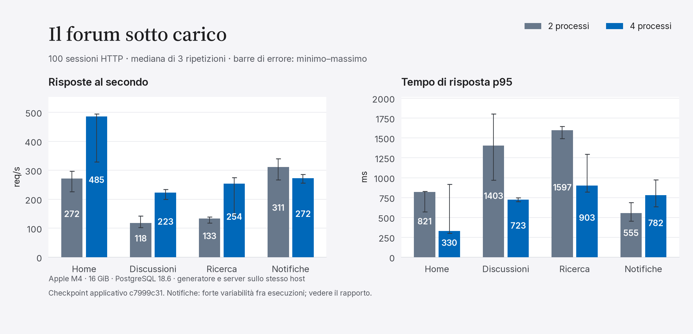
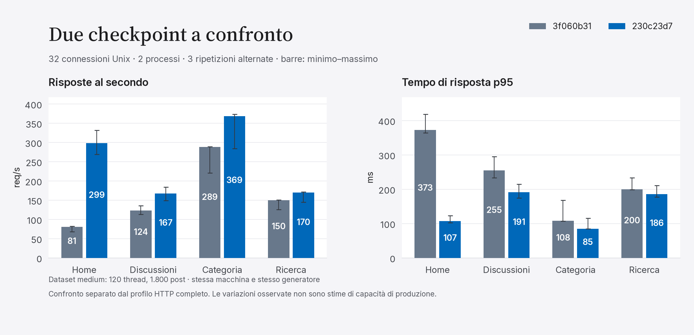

# Benchmark completo · 2 novembre 2026

Revisione applicativa misurata: [c7999c31](https://github.com/gipidevdor/GPForum/commit/c7999c31cfd8aa77e57ba052554d890a786221ae). Strumenti di capacità [0f360b33](https://github.com/gipidevdor/GPForum/commit/0f360b336218a4052fd9cf9f992c4d06c0aaac01) e diagnostica [230c23d7](https://github.com/gipidevdor/GPForum/commit/230c23d7b9c477b773db183d49abf9fc36fb9228). Le copie del codice sono isolate e immutabili durante le misure.

Misure locali su Apple M4 (10 core, 16 GiB), Perl 5.44.0, Mojolicious 9.51 e PostgreSQL 18.6. Generatore, server e database condividono la macchina; queste misure descrivono questa fixture e non una capacità di produzione garantita.

Il profilo completo ha eseguito tutte le **282 celle** previste: **65.830 richieste HTTP**, **zero risposte inattese**. Thread e risposte creati sono verificati contro i conteggi persistiti. Il carico usa 240 thread, 4.800 post iniziali e 103 utenti di fixture, con sessioni reali e durabilità PostgreSQL attiva.

Sono coperti 70 scenari di lettura, dieci percorsi di scrittura, carico misto e autenticazione. Il benchmark esteso include i 13 plugin, anteprime delle equazioni, pannelli amministrativi e verifica del salvataggio e della disattivazione/riattivazione dei plugin.

## Pagine autenticate a 100 sessioni concorrenti

Mediana di tre ripetizioni per cella. req/s indica risposte HTTP al secondo; p95 indica il tempo entro cui termina il 95% delle richieste nella singola cella. La tabella riporta la mediana dei tre p95, non il percentile di campioni uniti.

| Pagina | 2 processi req/s | 4 processi req/s | p95 2 processi (ms) | p95 4 processi (ms) |
| --- | ---: | ---: | ---: | ---: |
| Home | 271.6 | 485.5 | 820.9 | 329.8 |
| Discussioni | 117.8 | 223.4 | 1403.1 | 723.3 |
| Ricerca | 133.0 | 254.2 | 1596.8 | 903.4 |
| Notifiche | 310.9 | 272.2 | 555.0 | 782.5 |

**Variabilità e fallimenti restano visibili.** La prima esecuzione con quattro processi ha registrato una chiusura prematura della connessione nella home, c=10, ripetizione=1. Il risultato è marcato fail e preservato integralmente. Il confronto principale usa il rerun completo senza errori; il primo tentativo non viene usato per scegliere valori migliori.

Le notifiche mostrano forte variabilità fra esecuzioni: il rerun principale a quattro processi misura 272.2 req/s, mentre il primo tentativo ne misura 621.1 e una successiva prova isolata 617.3. Nella prova isolata le richieste risultano distribuite fra tutti e quattro i worker (quota massima 25.8–26.5%). Questo non dimostra la causa della differenza e non giustifica una promessa di scalabilità uniforme.

## Confronto con la versione precedente

Confronto separato mediante listener Unix, dataset medium e due processi server: revisioni 3f060b31 e 230c23d7, tre ripetizioni, ordine alternato e invertito. Ogni lettura deve restituire HTTP 200. Le cifre seguenti sono a 32 connessioni; questa fixture non è confrontabile in valore assoluto con il profilo HTTP completo sopra.

| Pagina | Prima req/s | Checkpoint misurato req/s | Variazione osservata | Prima p95 (ms) | Checkpoint misurato p95 (ms) |
| --- | ---: | ---: | ---: | ---: | ---: |
| Home | 80.7 | 298.7 | +270.2% | 372.5 | 107.3 |
| Discussioni | 123.7 | 167.3 | +35.3% | 254.7 | 191.4 |
| Categoria | 289.0 | 368.7 | +27.6% | 108.3 | 85.3 |
| Ricerca | 150.3 | 170.0 | +13.1% | 199.7 | 185.8 |

Le variazioni sono osservazioni comparative locali; tre ripetizioni brevi non costituiscono una stima statistica della capacità di produzione. Per categoria e ricerca, gli intervalli osservati del throughput si sovrappongono fra i checkpoint: le percentuali non vengono classificate come miglioramenti confermati.

## Costi a singolo client

Le cinque letture più costose per p95 nel profilo completo, senza carico concorrente. Mediana di tre celle; N è il totale dei campioni. Il dataset e il numero di messaggi dell'archivio condizionano questi tempi.

| Scenario | N | p50 mediano (ms) | p95 mediano (ms) |
| --- | ---: | ---: | ---: |
| guest.category_archive | 60 | 253.4 | 260.3 |
| admin.dashboard | 300 | 76.4 | 85.8 |
| admin.status | 300 | 75.1 | 79.6 |
| guest.health_ready | 300 | 40.7 | 43.9 |
| admin.metrics | 300 | 33.5 | 35.4 |

Le chiamate SQL seguenti sono obiettivi diagnostici, con almeno 20 osservazioni successive e ritorno senza eccezione. I test usano fixture, errori e contese diverse; questi numeri non sono una misura di capacità HTTP.

| Operazione SQL | N | p95 (ms) |
| --- | ---: | ---: |
| forum_store_write | 29 | 18.9 |
| forum_create_reply | 38 | 15.7 |
| forum_write_command | 44 | 15.0 |
| search_ranked | 183 | 11.0 |
| identity_second_factor_challenge_answer | 20 | 10.2 |

## Coda outbox

Trasporto no-op: claim, rinnovo, dispatch e conferma usano PostgreSQL reale, senza inviare email o richieste esterne. 1.000 messaggi per cella, tre ripetizioni, ordine dei worker alternato. La migrazione e il seed sono fuori dall'intervallo misurato.

| Worker | Messaggi/s, mediana | Messaggi confermati per prova | Persi | Duplicati |
| ---: | ---: | ---: | ---: | ---: |
| 1 | 1953.3 | 1000 | 0 | 0 |
| 2 | 2978.3 | 1000 | 0 | 0 |
| 4 | 2957.9 | 1000 | 0 | 0 |

Tutte le nove celle passano: 9.000 consegne no-op confermate, senza perdite o duplicati. I percentili nel JSON sono tempi per batch, non latenze end-to-end dei messaggi.

## Copertura e diagnostica

La diagnostica ha attraversato 150 file di integrazione: 147 eseguiti e tre esclusioni motivate. Le 13.832 asserzioni eseguite passano, così come le 350 del supplemento HTTP. L'unione delle osservazioni registra **178/218 rotte HTTP** e **335/351 operazioni SQL catalogate**. Copertura parziale e assenza di una risposta 2xx sono esplicite nei JSON; un redirect legittimo non è un fallimento del test. Una funzione SQL ritornata senza eccezione può comunque rifiutare un comando di dominio.

Le tre esclusioni di suite nel passaggio principale sono ClamAV reale non configurato, esperimenti che richiedono un cluster esplicitamente controllato e pg_stat_statements non precaricato. I riepiloghi TAP le elencano. Chiamate interne fra funzioni PostgreSQL non sono nuove esecuzioni DBI osservate. Le operazioni ancora non osservate sono elencate in summary.json.

La diagnostica SQL include errori intenzionali e fixture differenti. Tempi di chiamate, query e transazioni aiutano a riprodurre i percorsi; non sono confrontabili con il carico HTTP non strumentato. Le prove con traccia hanno diagnostic_trace=1 e non entrano nel confronto di capacità.

## Evidenze

- **[Dettaglio dei tempi: tutte le pagine, carichi, plugin, scritture e componenti SQL](TIMINGS.md)**

- [Profilo completo a due processi: JSON](full-workers2/http-complete.json) · [tabella HTML](full-workers2/report.html)
- [Primo tentativo a quattro processi, fail preservato](hot-workers4-attempt1/http-complete.json)
- [Rerun a quattro processi](hot-workers4-confirm/http-complete.json) · [prova isolata notifiche](notifications-workers4/http-complete.json)
- [Matrice HTTP e intervalli CSV](http-summary.csv) · [confronto revisioni CSV](comparison-summary.csv) · [campioni del confronto JSONL](socket-comparison.jsonl)
- [Diagnostica operazioni](operations/operations.json) · [riepilogo test](operations/test-summary.txt)
- [Supplemento HTTP strumentato](operations-http/operations.json) · [riepilogo test](operations-http/test-summary.txt)
- [Outbox JSON](outbox.json) · [riepilogo e copertura](summary.json) · [provenienza](provenance.json) · [SHA-256](SHA256SUMS)

## Riproduzione

Usare un checkout e cluster temporanei. I comandi HTTP e diagnostici creano e fermano le proprie risorse. Le due sorgenti del confronto socket hanno dipendenze bloccate installate e un cluster temporaneo fornito da GPForum::Test::TemporaryPostgres.

    script/gpforum-carton exec script/benchmark-http-complete --output artifacts/http-full --workers 2 --iterations 100 --warmup 5 --duration 5 --repetitions 3 --concurrency 1,10,50,100 --deadline 1800
    script/gpforum-carton exec script/benchmark-http-complete --output artifacts/http-4 --workers 4 --iterations 100 --warmup 5 --duration 5 --repetitions 3 --concurrency 1,10,50,100 --scenario member.home --scenario member.thread --scenario member.search --scenario member.notifications
    script/gpforum-carton exec script/benchmark-operations --output artifacts/operations --jobs 2
    script/gpforum-carton exec script/benchmark-operations --output artifacts/operations-http --test t/integration/postgres-http-complete.t --jobs 1
    script/gpforum-carton exec perl -Ilib -It/lib -MGPForum::Test::TemporaryPostgres script/performance-outbox.pl --json --messages 1000 --workers 1,2,4 --repetitions 3

Per outbox e confronto socket l'ambiente della raccolta pubblicata rimuove tutte le variabili GPFORUM_ ereditate prima di avviare il cluster, così una configurazione del forum in uso non diventa il target del test. La provenienza riporta gli argomenti del confronto.

Le misure riguardano HTTP server e PostgreSQL locali, con limiti di ammissione innalzati soltanto nell'entrypoint del benchmark e contatori PostgreSQL conservati. Background delivery disattivata, cache SSR locale normale e GlifiStore non attivato, nessun TLS/proxy/WAN né rendering del browser. CPU macOS è la media indicativa di ps; RSS è una fotografia di confine che può contare memoria condivisa più volte. Le librerie e risorse esterne dei plugin non vengono contattate.

Le tabelle HTML espongono tutti i percentili e le celle. Le figure e i CSV usano soltanto gli aggregati definiti sopra: min–max fra ripetizioni, senza confonderli con intervalli di confidenza.
