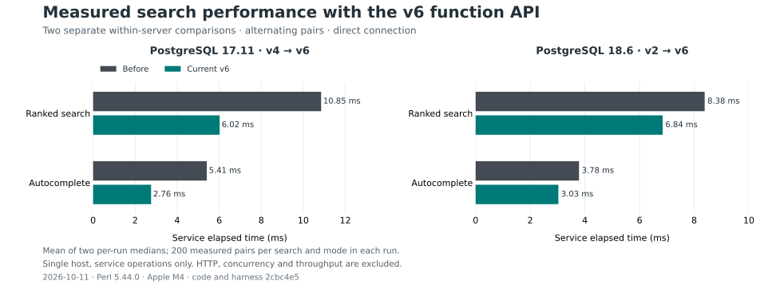
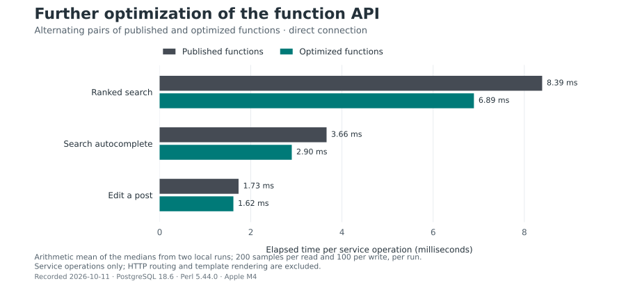

# PostgreSQL function API: second optimization

This follows the [initial DBIx-to-function conversion](sql-functions-performance.md).
The comparison uses the already published function API as its baseline.
The current catalogue has 195 operations. The SQL lives in new immutable
migrations; applying them and reprovisioning the runtime role are operator
steps, separate from publishing or merging the code.

## Changes

[Migration 100](../../migrations/100_optimized_search_functions.sql) introduces
ranked search and autocomplete v3 implementations with narrow v4 definer
boundaries. The search candidate limit still follows the same ACL and live
placement checks. Ranking carries identifiers and ranking inputs through the
sort; a materialized result page bounds the subsequent body, title and author
lookups. The existing v1/v2 functions remain installed. Filter, date boundary,
rank, capped-candidate count, result order and application JSON remain equivalent.

[Migration 101](../../migrations/101_forum_post_context_functions.sql) introduces
`forum_post_context_v1/v2`. Modification, deletion and restoration fetch the
post and the existing thread head in one call. The shared thread visibility
gate still runs before the atomic write. Each successful workflow now needs
two client calls rather than three. Domain refusals, idempotency and the
write's lock order remain unchanged.

[Migration 102](../../migrations/102_search_custom_plans.sql) adds search v5
implementations and narrow v6 definer entry points. The query bodies and return
contracts are identical to v3/v4, but the invoker implementation uses static
PL/pgSQL `RETURN QUERY` with `force_custom_plan`. PostgreSQL 16/17's SQL-language
functions retain parameter-generic plans; the parameter-aware SQL-function
cache was introduced in PostgreSQL 18. The [upstream implementation change](https://www.postgresql.org/message-id/E1u02Tn-002Kp0-0Q@gemulon.postgresql.org)
and [release notes](https://www.postgresql.org/docs/18/release-18.html) document
that distinction. Static PL/pgSQL applies the existing plan policy on all three
supported versions, without dynamic SQL or changes to the ACL predicates.
The catalogue now calls v6; previous v2/v4 entry points remain installed for
an explicit rollback, but runtime provisioning grants only the current API.

On the maintained 20,000-document fixture, the controlled PostgreSQL 17
prototype changed the common candidate path from a 20,000-row bitmap heap
scan to a 1,000-row ordered index walk, while returning identical results.
The [custom-plan evidence](evidence/sql-functions-2026-10-11-custom-plan-validation.json)
retains the original PostgreSQL 17 CI plans, controlled prototype plans,
query-body equality hashes and the final v6 test fingerprints. Captured plan
times include diagnostics and are not service benchmark latency.

The optional ordered autocomplete index was measured and rejected: it did
not give a stable improvement and would add maintenance cost. No new index
is shipped in this batch.

## Current v6 service measurements

The code and harness are recorded at [`2cbc4e5`](https://github.com/gpicchiarelli/GPForum/commit/2cbc4e56951ce9707f9dd1eb1c06ccbe9ba98b96).
Six successful runs produced 12,000 individual measured samples on 2026-10-11,
14:51–14:53 UTC. Each comparison ran twice with 15 warm-up pairs, 200 measured
read pairs and 100 measured edit pairs per connection mode. Odd pairs run
before/after; even pairs run after/before on the same handle and dataset.
Each search pair must produce identical service JSON. All 2,400 measured edits
returned distinct revisions within their run; command IDs and bodies change
on every edit. Revision retrieval occurs outside the timed interval.

Tables show arithmetic means of the two per-run medians and p95 values in
milliseconds and mean Perl CPU per operation. Quantiles are not pooled; the
canonical sorted-sample index is `int(q * (n - 1) + 0.5)`, selecting the upper
central observation for an even-sample median.

### PostgreSQL 17: isolate migration 102 (v4 → v6)

Both sides use the same combined post context and atomic writer. Thus the
search difference isolates the parameter-aware implementation; post editing
is an unchanged control with two calls on both sides.

| Operation | Direct median before → after | Median change | p95 before → after | Perl CPU before → after | Calls |
| --- | ---: | ---: | ---: | ---: | ---: |
| Ranked search | 10.85 → 6.02 | -44.5% | 11.46 → 6.15 | 0.834 → 0.832 | 1 → 1 |
| Autocomplete | 5.41 → 2.76 | -49.0% | 5.52 → 2.85 | 0.334 → 0.333 | 1 → 1 |
| Edit a post | 2.06 → 2.05 | -0.7% | 2.52 → 2.49 | 0.385 → 0.388 | 2 → 2 |

| Operation | Proxy median before → after | Median change | p95 before → after | Perl CPU before → after | Calls |
| --- | ---: | ---: | ---: | ---: | ---: |
| Ranked search | 12.15 → 7.34 | -39.6% | 12.39 → 7.48 | 0.839 → 0.839 | 1 → 1 |
| Autocomplete | 6.74 → 4.14 | -38.6% | 6.88 → 4.22 | 0.343 → 0.343 | 1 → 1 |
| Edit a post | 5.97 → 5.99 | +0.3% | 6.85 → 6.93 | 0.636 → 0.651 | 2 → 2 |

Search medians improved in both runs. The unchanged edit control varied by
−0.7% direct and +0.3% through the proxy; the latter increase is retained.
These small control differences are not evidence of a post-edit optimization.

### PostgreSQL 17 and 18: original v2 → current v6

These comparisons include both the search changes and the combined post
preflight from migration 101. They are separate within-server comparisons;
the table does not establish a performance ranking between server versions.

| PostgreSQL | Operation | Direct median before → after | Median change | Direct p95 before → after | Proxy median before → after | Calls |
| --- | --- | ---: | ---: | ---: | ---: | ---: |
| 17.11 | Ranked search | 15.12 → 6.18 | -59.1% | 15.76 → 6.35 | 15.93 → 7.54 | 1 → 1 |
| 17.11 | Autocomplete | 7.37 → 2.78 | -62.2% | 7.63 → 2.88 | 8.84 → 4.20 | 1 → 1 |
| 17.11 | Edit a post | 2.15 → 2.06 | -4.2% | 2.39 → 2.32 | 8.14 → 6.41 | 3 → 2 |
| 18.6 | Ranked search | 8.38 → 6.84 | -18.4% | 8.69 → 7.15 | 9.94 → 8.39 | 1 → 1 |
| 18.6 | Autocomplete | 3.78 → 3.03 | -20.0% | 4.11 → 3.30 | 6.17 → 5.43 | 1 → 1 |
| 18.6 | Edit a post | 2.68 → 2.46 | -8.2% | 3.08 → 2.82 | 8.42 → 6.36 | 3 → 2 |



The proxy delays each direction by 0.5 ms. Editing through the proxy improved
by 21.3% on PostgreSQL 17 and 24.5% on PostgreSQL 18 in the v2 comparisons.
Raw evidence retains all operations, direct/proxy medians, p95, CPU and
individual samples:

- pg17-v2: [run 1](evidence/sql-functions-2026-10-11-v6-pg17-v2-1.json) and [run 2](evidence/sql-functions-2026-10-11-v6-pg17-v2-2.json).
- pg17-v4: [run 1](evidence/sql-functions-2026-10-11-v6-pg17-v4-1.json) and [run 2](evidence/sql-functions-2026-10-11-v6-pg17-v4-2.json).
- pg18-v2: [run 1](evidence/sql-functions-2026-10-11-v6-pg18-v2-1.json) and [run 2](evidence/sql-functions-2026-10-11-v6-pg18-v2-2.json).

The [current validation and aggregation manifest](evidence/sql-functions-2026-10-11-v6-validation.json)
records source hashes, sample counts, commands, local integration results and
the new NYTProf capture. Pairing reduces order and host-load bias; it does
not eliminate it. These measurements use a fixture account on one host,
exclude HTTP, concurrency and throughput, and make no statistical-significance
or production-latency claim.

To reproduce, use the recorded code/harness checkout and an account allowed
to create databases. Choose the PostgreSQL 17 or 18 connection; use baseline
`4` to isolate migration 102, or `2` for the original API comparison:

```sh
GPFORUM_DATABASE_DSN='dbi:Pg:dbname=postgres;host=127.0.0.1;port=55437' \
GPFORUM_DATABASE_USER=gpforum \
script/gpforum-carton exec script/bench-sql-functions \
  --paired-functions --before-search-version 4 \
  --implementation-reference 2cbc4e56951ce9707f9dd1eb1c06ccbe9ba98b96 --json
```

The harness migrates, seeds and drops its own database. Current v6 is selected
from the catalogue. Historical v4 measurements below use their recorded
harness and remain available for audit.

## Published v2-to-v4 service measurements on PostgreSQL 18

The recorded [benchmark](../../script/bench-sql-functions) accepted
`--paired-functions`. Both sides used stored functions: the published search
v2 and two-call post preflight are compared with search v4 and the combined
context. The adapter, atomic write function, database handle and dataset are
shared. This isolates the changed paths; it is not a comparison of two complete
application binaries. The implementation reference is
[`27ec747`](https://github.com/gpicchiarelli/GPForum/commit/27ec747bcf2acbe50c9c4221c37f1610cf09add3),
the published baseline is
[`2cb9945`](https://github.com/gpicchiarelli/GPForum/commit/2cb994530612205a422f9f0ba45078d5bc920b51),
and the measured harness is
[`8316f28`](https://github.com/gpicchiarelli/GPForum/commit/8316f283a12b2894951ab4c892e1f6324e611a7f).

Each run warms up with 15 pairs, then measures 200 read pairs and 100 write
pairs per connection mode. Odd pairs run before/after; even pairs run
after/before. Every search pair must return identical service JSON. Every
edit uses a new body and command ID and must write a revision. Raw records
retain wall time, Perl CPU, pair number, execution order, statements and
client round trips. Two runs contain 4,000 individual measured samples.

The tables give arithmetic means of the two per-run medians and p95 values
in milliseconds, and mean Perl CPU per operation. Quantiles are not pooled.
The harness sorts samples and selects zero-based index
`int(q * (n - 1) + 0.5)` for quantile `q`; with an even sample count its
median selects the upper central observation. Each operation's median
improved in both runs.

| Operation | Direct median before → after | Reduction | Direct p95 before → after | Direct CPU before → after | Calls before → after |
| --- | ---: | ---: | ---: | ---: | ---: |
| Ranked search | 8.39 → 6.89 | 17.8% | 9.87 → 8.28 | 1.424 → 1.309 | 1 → 1 |
| Autocomplete | 3.66 → 2.90 | 20.8% | 5.19 → 3.82 | 0.464 → 0.420 | 1 → 1 |
| Edit a post | 1.73 → 1.62 | 6.6% | 2.30 → 2.01 | 0.481 → 0.389 | 3 → 2 |



The proxy adds 0.5 ms in each direction. Its results show the effect of the
removed post-context round trip.

| Operation | Proxy median before → after | Reduction | Proxy p95 before → after | Proxy CPU before → after |
| --- | ---: | ---: | ---: | ---: |
| Ranked search | 10.29 → 8.65 | 16.0% | 11.85 → 10.16 | 1.604 → 1.488 |
| Autocomplete | 6.31 → 5.36 | 15.1% | 7.84 → 6.85 | 0.579 → 0.525 |
| Edit a post | 8.13 → 6.42 | 20.9% | 9.02 → 7.29 | 0.889 → 0.726 |

The raw [first run](evidence/sql-functions-2026-10-11-paired-1.json) and
[second run](evidence/sql-functions-2026-10-11-paired-2.json) include all samples.
They use PostgreSQL 18.6, Perl 5.44.0, an Apple M4 with 16 GiB and macOS 27.0.1.
Both paths use the fixture account; restricted-login correctness is tested
separately. Pairing reduces order and host-load bias but does not eliminate
it. These are service measurements on one host, excluding HTTP, concurrency
and throughput; no statistical significance or production latency is claimed.

To reproduce these historical v4 results, use the recorded harness checkout
`8316f283a12b2894951ab4c892e1f6324e611a7f` and a database account allowed to
create databases. The current harness follows the current v6 catalogue;
the updated comparisons are reported separately above.

```sh
GPFORUM_DATABASE_DSN='dbi:Pg:dbname=postgres;host=127.0.0.1;port=55433' \
GPFORUM_DATABASE_USER=gpforum \
script/gpforum-carton exec script/bench-sql-functions --paired-functions --json
```

The harness migrates, seeds and drops its own database. Set the connection
and credentials for the local test server; it does not use a deployed forum.

## Earlier full service measurements

The original 20-operation harness ran twice on the published code and twice
on the optimized code. Each run created, migrated, seeded and dropped its own
database. This preserves the [original workload and measurement method](sql-functions-performance.md#measurement-method):
15 warm-ups, 200 read or 100 write samples, direct access and a proxy delaying
each direction by 0.5 ms, service elapsed time, p95, Perl CPU, exclusive DBIx/DBI
profiling, statements and client round trips. These runs exclude HTTP.

The table gives arithmetic means of the two per-run medians in milliseconds.
All four runs are retained, including the variable second optimized run.

| Operation | Direct before → after | Direct median change | Proxy before → after | Calls before → after |
| --- | ---: | ---: | ---: | ---: |
| Ranked search | 7.82 → 7.27 | −7.0% | 10.94 → 7.95 | 1 → 1 |
| Autocomplete | 3.57 → 2.91 | −18.5% | 6.17 → 5.69 | 1 → 1 |
| Edit a post | 1.38 → 1.61 | +16.9% | 9.43 → 5.35 | 3 → 2 |

The second optimized run slowed several unchanged operations too: the member
thread page median rose from 0.457 ms in optimized run 1 to 0.702 ms in run 2.
A process snapshot immediately afterward showed substantial CPU consumption
by unrelated SBCL and macOS indexing/file-provider processes. This is evidence
of host variation; it does not prove the cause of every slow sample. The full
runs do not establish a stable improvement in local post-edit latency; this
motivated the alternating comparison above. These records remain published.

The baseline code was
[`2cb9945`](https://github.com/gpicchiarelli/GPForum/commit/2cb994530612205a422f9f0ba45078d5bc920b51);
the optimized code was
[`27ec747`](https://github.com/gpicchiarelli/GPForum/commit/27ec747bcf2acbe50c9c4221c37f1610cf09add3).
The database was PostgreSQL 18.6, Perl 5.44.0, on an Apple M4 with 16 GiB
running macOS 27.0.1. Both paths used the fixture account; restricted-login
correctness is tested separately.

Raw measurements include every operation's median, p95, CPU, profiling and counts:

- Baseline [run 1](evidence/sql-functions-2026-10-11-optimization-before-1.json)
  and [run 2](evidence/sql-functions-2026-10-11-optimization-before-2.json).
- Optimized [run 1](evidence/sql-functions-2026-10-11-optimization-after-1.json)
  and [run 2](evidence/sql-functions-2026-10-11-optimization-after-2.json).

## Exploratory search measurement

A separate exploratory comparison used 1,100 additional real threads and
1,100 posts, about 12 KB of body text per document, a 1,000-candidate cap and
20-row page. It alternated v2/v4 calls in each measured pair, with five warm-up
calls per version and 60 samples per version per case in each of two rounds.
The timed unit was `SqlFunction->rows`: binding, execution and fetching rows;
parameter construction, service decoration and HTTP were excluded.
This temporary helper used the mean of the two central sorted samples for its
median and the 57th sorted sample out of 60 for p95. Its median differs from
the canonical harness rule documented above; the p95 selects the same
observation as the canonical index for 60 samples.

| Case, without a new index | Mean of v2 medians | Mean of v4 medians | Reduction |
| --- | ---: | ---: | ---: |
| Ranked query `Depth` | 12.58 ms | 7.59 ms | 39.7% |
| Autocomplete prefix `Dep` | 3.49 ms | 2.78 ms | 20.3% |

The [56 exploratory records and method metadata](evidence/sql-functions-2026-10-11-search-exploration.json)
retain both the no-index stage and the rejected ordered-index experiment.
The latter finished with a newest-first plan assertion failure after index
creation and `ANALYZE`; it is not shipped validation. This temporary variant
of the integration fixture saved median/p95 summaries, not individual samples
or plan JSON, and is not the canonical service benchmark. The original fixture
without that index passed 437 local checks; the first strengthened fixture
passed 441 on PostgreSQL 18. The current v2/v4/v6 fixture passes 861.

## Validation and activation

- The published [PostgreSQL 16/17/18 matrix](https://github.com/gpicchiarelli/GPForum/actions/runs/38149645006)
  passed on main commit `6069be8`, whose seven changed SQL/API/test/harness
  source files are byte-identical to measured commit `2cbc4e5`. Each server
  passed all 861 search checks, including the bounded current-v6 index path
  and restricted-login grants. PostgreSQL 16.15 and 17.11 passed 97 files and
  10,482 assertions; the standby test skips there because matching `initdb`
  and `pg_ctl` are absent from PATH. PostgreSQL 18.6 passed 97 files and 10,505
  assertions. ClamAV skips in all three matrix jobs. Fresh migrations,
  no-op reapplication, upgrade from 101 to 102, dump/restore and drill-evidence
  validation passed on every server. The source equality, job results,
  selected assertions and log hashes are preserved in the
  [current validation manifest](evidence/sql-functions-2026-10-11-v6-validation.json).
- [Security scanning](https://github.com/gpicchiarelli/GPForum/actions/runs/38149645042)
  and [repository hygiene](https://github.com/gpicchiarelli/GPForum/actions/runs/38149644975)
  passed on that same main commit.
- The current complete local `make -j3 check` passed: 498 visited test files
  and 16,169 assertions (401 unit files plus 97 integration files visited
  without DSN), syntax and formatting for 1,372 Perl files, strict style
  with 15 historical violations and zero new ones, system Perl and architecture.
  The source commit was `2cbc4e5`; the head moved to the documentation-only
  publication `5b4b399` during the run, with all 1,372 source fingerprints
  unchanged. The locale and HTTP/TLS regression tests both executed and passed.
  Most database tests skip without DSN; the real integration tiers below
  cover them. Commands, timestamps and hashes are in the
  [current validation manifest](evidence/sql-functions-2026-10-11-v6-validation.json).
- The complete integration tier on the current v6 code commit
  [`2cbc4e5`](https://github.com/gpicchiarelli/GPForum/commit/2cbc4e56951ce9707f9dd1eb1c06ccbe9ba98b96)
  passed on PostgreSQL 17.11 and 18.6: 97 files and 10,505 assertions per
  cluster. The local host authentication is trust; these runs prove runtime
  privileges, not mandatory password/SCRAM authentication. The PostgreSQL
  16/17/18 CI matrix uses its separately configured services.
- The complete `make -j3 check` quality gate passed on clean commit
  [`013dd56`](https://github.com/gpicchiarelli/GPForum/commit/013dd56c48229df986db89502db1247b3f622f36):
  system Perl, syntax for 1,369 files, the suite without DSN (400 unit files
  and 96 integration files visited, 16,162 assertions), strict style with
  zero new violations, formatting and architecture. Most database integration
  tests skip without DSN; the separately executed tier below verifies them.
  The [validation evidence](evidence/sql-functions-2026-10-11-optimization-validation.json)
  records tested commits, counts, benchmark summaries and raw artifact hashes.
- The complete PostgreSQL integration tier passed on the isolated committed
  v4 checkout: 96 files and 9,916 assertions. The benchmark smoke test checks
  paired sample counts, balanced order, exact comparisons and disposable
  database cleanup on success and on a missing-routine failure.
- Both new integration tests passed under NYTProf 6.15 and decoded to CSV.
  The [profile metadata and selected subroutine summaries](evidence/sql-functions-2026-10-11-optimization-profile.json)
  record commands, tested commit, times, call counts and artifact hashes.
  Profiling includes fixtures and both comparison paths, database waits and
  profiler overhead; those times are not operation latency. The large binary
  profiles and full CSV exports remain local and can be reproduced with the
  recorded commands.
- The current v6 search fixture also passed all 861 checks under NYTProf 6.15
  on PostgreSQL 17. The
  [current profile and integration metadata](evidence/sql-functions-2026-10-11-v6-validation.json)
  records the 19.77-second whole-test capture, decoded subroutine summaries,
  commands and hashes for the local binary and 802 CSV files. This includes
  fixtures, all three API versions, plan collection, database waits and
  profiler overhead; it is separate from service latency measurements.
- [Search differential and plan test](../../t/integration/postgres-search-optimization.t):
  861 checks on PostgreSQL 17 and 18, covering exact service JSON and raw typed
  rows for v2/v4/v6, ACL combinations,
  candidate cap after filtering, dates, ties, stale category/space moves,
  nullable authors and Unicode/wildcard prefixes. A separate maintained corpus
  of 20,000 added documents checks actual nested plans: current v6 uses the
  common newest-first index and stops at 1,000 candidates, ranks 1,000,
  materializes a 20-row page and loads at most 20 payload rows. Retained v2/v4
  are compared for exact results and ranking/page bounds, with their scan
  choices recorded as diagnostics rather than requiring the legacy defect
  to be fixed in immutable definitions.
  The rare-query GIN assertion is retained. Assertions use the primary plans
  without planner overrides; the collector's separate forced diagnostics are
  excluded from these assertions and the published comparison.
- [Combined context and restricted-login test](../../t/integration/postgres-sql-function-post-context.t):
  86 checks, covering legacy column/timestamp/boolean representations,
  inherited visibility, domain refusals, malformed IDs, edit/delete/restore,
  replay, conflicts and two-call workflow counts.
- The real runtime login can call search v6 and the post context, while direct
  table access, historical search v1/v2/v3/v4 and current implementation v5
  calls fail.
  The static and live catalogue gates explicitly recognize retained versions
  and require exact typed forwarding for every definer boundary.
  Their focused runs pass 2,737 assertions on each local server version.
- The current benchmark smoke test passes 350 checks, covering baseline 2/4
  selection, real edit revisions, balanced sample order and disposable database
  cleanup on success and a missing-routine failure. It also passes in both
  complete PostgreSQL integration tiers recorded above.
- The previous general CI exposed two failures outside the SQL paths:
  locale-dependent child-process stderr and TLS handshake classification.
  The locale failure is observed directly; the specific newer OpenSSL variant
  was inferred because the old log omitted its message. Regression fixtures
  now cover unavailable locales, handshake variants and certificate/read errors.

The first PR run on PostgreSQL 16, 17 and 18 failed the index expectation on
the smaller corpus after the visibility/placement mutation matrix. Its actual
v4 plan scanned 2,200 matching documents, but still ranked 1,000 and fetched
20 payload rows. In a controlled local comparison, both v2 and v4 selected a
sequential scan on the refreshed 2,200-document corpus and the ordered index
on the fresh 20,000-document corpus on PostgreSQL 18. This first repair exposed
an additional version difference: PostgreSQL 16/17 used parameter-generic
plans and scanned 20,000 documents even in the maintained fixture, for both
v2 and v4. PostgreSQL 18 passed that same gate. The new v6 implementation
restores the ordered 1,000-candidate path on PostgreSQL 17 as well. Automatic
statistics timing in the original small-fixture CI was not recorded.

The test now checks the large workload independently of the semantic mutation
matrix, compares all three real function bodies, and fails bounds checks if a plan
node is missing. [Original CI plans, controlled comparison and source hashes](evidence/sql-functions-2026-10-11-search-plan-validation.json)
preserve the initial investigation. Migration 102 corrects the subsequently
observed PostgreSQL 16/17 planning limitation; migrations 100/101 and all
historical raw measurements remain unchanged.

Apply migrations 100, 101 and 102 with the ordinary migration owner, drain old
processes, reprovision using the new catalogue and start the updated release.
Reprovisioning grants current search v6 rather than v2/v4. The
[runtime role runbook](../ops/sql-api-role.md) includes upgrade and rollback
steps and the separate optional Minion queue database boundary.
