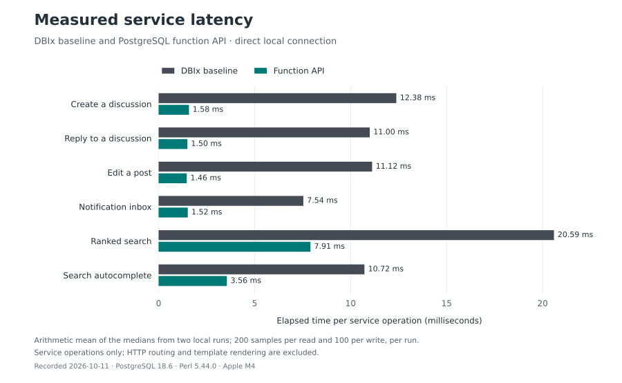

# PostgreSQL function API: changes and measured performance

The PostgreSQL runtime now uses 194 versioned catalogue operations. The
adapter prepares fixed, typed function calls once per connection. DBIx::Class
continues to supply the schema and transaction connection; it no longer
builds application data statements on the PostgreSQL runtime paths.

The conversion was published in [PR #59](https://github.com/gpicchiarelli/GPForum/pull/59),
merged into `main` on 2026-10-11 as
[`70547ce`](https://github.com/gpicchiarelli/GPForum/commit/70547ce5dd27e0254c9f2830ef2e3ae7c72d5a77).
The definitions, adapters, tests, reproduction tool and two measured runs
are in the repository. Production activation follows the operator steps
below; merging code does not install routines into another database.

## Main results

These are arithmetic means of the two local direct-access medians, in
milliseconds. They compare the same service operation through DBIx and
through the function API; full HTTP request latency is outside this test.

| Service operation | DBIx | Function API | Median reduction | Client round trips |
| --- | ---: | ---: | ---: | ---: |
| Create a discussion | 12.38 | 1.58 | 87.2% | 43 → 2 |
| Reply | 11.00 | 1.50 | 86.4% | 33 → 2 |
| Edit a post | 11.12 | 1.46 | 86.8% | 32 → 3 |
| Notification inbox | 7.54 | 1.52 | 79.9% | 1 → 1 |
| Ranked search | 20.59 | 7.91 | 61.6% | 1 → 1 |
| Search autocomplete | 10.72 | 3.56 | 66.8% | 1 → 1 |



All 20 measured operations improved their direct medians in both runs.
The reduction of the averaged medians ranges from 26.6% to 93.1%; this
range describes individual operations and does not measure overall forum
throughput. The full table includes p95, CPU and delayed-network results.

## What changed

The [catalogue](../../lib/GPForum/Infrastructure/SqlFunctionCatalogue.pm)
defines the 194 allowed operation signatures, and the
[adapter](../../lib/GPForum/Infrastructure/SqlFunction.pm) binds parameters
to fixed, typed calls. PostgreSQL executes the versioned routines and
returns rows or JSON. Existing permission, visibility, audit, idempotency
and transaction behavior is checked by differential and concurrency tests.

These stored routines are PostgreSQL **functions** (`CREATE FUNCTION`) in
the `api` schema. Their SQL definitions are in migration files, including
the function bodies and security settings. Applying migrations installs
them once; normal requests call the installed functions. Applied migration
files remain immutable, and future changes receive new migrations and
versioned entry points.

The restricted login is a separate enforcement step. Moving SQL into
functions alone does not remove an existing owner's table privileges.
Provisioning the runtime role makes PostgreSQL deny arbitrary reads or
writes of application tables while allowing the catalogue calls.

## Coverage and activation

| Runtime area | Implementation migrations |
| --- | --- |
| Thread pages and atomic replies | 052–054 |
| Sessions, viewers, permissions, rate limits and participation | 055 |
| Forum lists, posts, readability and writes | 056–057 |
| Notification reads | 058 |
| Identity, accounts, profiles, credentials and tokens | 060 |
| Events, audit, commands, outbox, worker claims and projections | 061 |
| Community, feeds, bookmarks, reputation and notification writes | 062 |
| Read markers and search | 063–064 |
| Moderation, reports, suspensions and administration | 065–066 |
| Attachments and scanning | 067 |
| Privacy, erasure, retention holds, import/export and plugins | 068 |
| Metrics, retention, readiness, budgets, realtime and replication | 069 |
| Partition horizon and outbox diagnostics | 070 |

[Migration 059](../../migrations/059_runtime_api_boundaries.sql) and
[migration 099](../../migrations/099_remaining_runtime_api_boundaries.sql)
expose hardened `_v2` entry points. For concrete function bodies, see
[forum writes](../../migrations/057_forum_write_functions.sql),
[search](../../migrations/064_search_functions.sql) and
[operational data](../../migrations/069_operations_realtime_functions.sql).
The implementation and helper functions have no public execution grants.
A separate runtime login receives only the current catalogue's function grants and owns no
objects. Tests connect with that login, exercise HTTP authentication and
application workflows, and verify that direct table reads and writes fail.
PostgreSQL still accepts session commands and expressions such as `SELECT 1`.

Activation is an operator step, documented in
[the runtime role runbook](../ops/sql-api-role.md). The migration owner must
be an ordinary role. The web and worker environment contains only the
restricted credentials; migrations and partition DDL use the operator
environment. This change does not switch an existing installation's login
or restart its services.

The previous service implementations remain available to in-memory test
doubles and the explicit benchmark baseline. Real PostgreSQL services select
the function path automatically, and an unconfigured real schema fails
instead of selecting a fallback.

## Measurement method

`script/bench-sql-functions` creates and drops its own database. Each complete
run uses the small performance seed, 3,000 posts with bodies, 1,500 indexed
threads and 30 notifications. It compares 20 service operations through the
old DBIx path and the new function path, including the `_v2` boundaries.
Both paths use the fixture connection because the legacy path requires table
access. Actual restricted-login behavior is verified separately by the role
and HTTP integration tests; this benchmark does not isolate the cost of
switching from the runtime login to a different function owner.

Each operation receives 15 warm-up calls and then 200 read or 100 write
samples. Direct access and a TCP proxy delaying each direction by 0.5 ms
are measured separately. The report includes the actual `SELECT 1` round
trip medians, elapsed median and p95, process Perl CPU, statement counts,
and transaction/savepoint round trips. A separate instrumented pass records
exclusive elapsed time inside DBIx::Class, DBI and the remaining Perl code.
Those profiling buckets are elapsed time, not CPU samples.

Each run starts from a fresh seed. Writes commit and grow that run's corpus;
they are not rolled back between samples. Within a run the order is direct
before proxy and DBIx before functions, with operation names sorted.
Warm-up, two independent runs and recorded p95 values expose variation,
but this is not a randomized experiment or a concurrency load test.

The measured unit is a service operation. HTTP routing, template rendering,
password hashing, mail delivery and complete production request latency are
outside this comparison. Results on this host do not imply the same gain
for every deployment or every one of the 194 API operations.

Reproduce after the quality and PostgreSQL integration gates have finished:

```sh
GPFORUM_DATABASE_DSN='dbi:Pg:dbname=postgres;host=127.0.0.1;port=55433' \
GPFORUM_DATABASE_USER=gpforum \
script/gpforum-carton exec script/bench-sql-functions --json > /tmp/sql-functions.json
```

The benchmark connection needs permission to create databases. Its disposable
database also needs the privileges required for migrations and fixtures.

## Validation

- Full local workspace unit tier: 401 files, 16,137 assertions, passed.
- Full PostgreSQL integration tier: 94 files, 9,263 assertions, passed.
- After the CI authentication repair, all 94 files / 9,263 assertions also
  passed against a disposable PostgreSQL 18 server requiring SCRAM
  passwords. The two dedicated role tests passed 75 assertions; their
  fixtures supply throwaway passwords to DBI, the schema and the HTTP app.
- On the published head
  [`e8ed651`](https://github.com/gpicchiarelli/GPForum/commit/e8ed651a9c41ced751a141b36d8169ebcc1c530d),
  the [PostgreSQL matrix](https://github.com/gpicchiarelli/GPForum/actions/runs/38138925678)
  passed on versions 16, 17 and 18, including migration reapplication,
  the full integration tier and fresh/upgrade/dump-restore drills.
  The same [matrix passed on the merged commit](https://github.com/gpicchiarelli/GPForum/actions/runs/38139267582).
  [Security scanning](https://github.com/gpicchiarelli/GPForum/actions/runs/38138925751),
  [deployment units](https://github.com/gpicchiarelli/GPForum/actions/runs/38138925582)
  and [project hygiene](https://github.com/gpicchiarelli/GPForum/actions/runs/38138925690)
  also passed. The general CI and coverage result is tracked separately in
  [the implementation CI run](https://github.com/gpicchiarelli/GPForum/actions/runs/38138925676)
  and [the merge CI run](https://github.com/gpicchiarelli/GPForum/actions/runs/38139267621);
  coverage was not run locally.
- The [dated validation snapshot](evidence/sql-functions-2026-10-11-validation.json)
  records the tested commits, local counts and individual CI job states.
  At 12:33:43 UTC on 2026-10-11, general CI was still running on the
  published head and merge commit; the snapshot preserves that distinction.
- Additional verification after benchmark refactoring: migration gate and
  benchmark smoke test, 322 assertions, passed.
- Final checks after the last source edits: replication standby, restricted
  role workflows and provisioning CLI, 98 PostgreSQL assertions, passed.
- System Perl, syntax, architecture and Perl::Critic baseline gates passed;
  the critic gate reports no new violations.
- Full local repository formatting gate passed; a separate check of all 131
  changed Perl files also passed after the final edits.
- Differential tests preserve results, ACL filters, cursors, JSON, ranks,
  replay behavior and transaction outcomes. PostgreSQL tests cover concurrent
  writes, search indexing, deletion during login and outbox lease races.
- Nested query-plan checks exercise 20 reader endpoints, including a 20,000
  document search corpus and deep keyset pages. HTTP query-budget checks
  verify that statement counts stay bounded as page size grows.

## Recorded results

Measured on 2026-10-11, after all repository gates and PostgreSQL tests had
finished, with no other repository test or profiling process running.
Host: Apple M4, 16 GiB RAM, macOS 27.0.1; Perl 5.44.0; PostgreSQL 18.6
(Homebrew), local TCP connection.

- [Run 1 JSON](evidence/sql-functions-2026-10-11-run-1.json), completed
  11:59:19 UTC: measured round trip 0.030 ms direct, 1.488 ms through proxy.
- [Run 2 JSON](evidence/sql-functions-2026-10-11-run-2.json), completed
  12:01:44 UTC: measured round trip 0.029 ms direct, 1.407 ms through proxy.

Every table pair is **DBIx baseline → function API**. Values are arithmetic
means of the two per-run medians, p95s and per-call CPU measurements, rather
than quantiles pooled across runs. Times are milliseconds. The last column
counts client round trips, including explicit transaction and savepoint
commands; it does not count SQL statements executed inside a function.

| Operation | Direct median | Direct p95 | Median reduction | Proxy median | Perl CPU | Client round trips |
| --- | ---: | ---: | ---: | ---: | ---: | ---: |
| category_index_member | 1.430 → 0.228 | 1.958 → 0.260 | 84.0% | 2.604 → 1.795 | 1.370 → 0.086 | 1 → 1 |
| category_threads_member | 4.210 → 0.859 | 4.900 → 0.903 | 79.6% | 6.779 → 3.466 | 3.269 → 0.217 | 1 → 1 |
| home_page_member | 4.923 → 1.239 | 5.995 → 1.346 | 74.8% | 8.194 → 4.679 | 4.104 → 0.522 | 2 → 2 |
| latest_threads_member | 3.119 → 0.769 | 3.960 → 0.802 | 75.3% | 6.043 → 3.261 | 2.393 → 0.201 | 1 → 1 |
| mark_read | 1.901 → 0.294 | 2.199 → 0.354 | 84.5% | 11.332 → 4.598 | 1.222 → 0.115 | 7 → 3 |
| new_thread | 12.381 → 1.581 | 13.961 → 1.837 | 87.2% | 91.876 → 6.082 | 7.440 → 0.390 | 43 → 2 |
| notification_badge | 6.829 → 1.402 | 7.260 → 1.492 | 79.5% | 8.223 → 4.968 | 6.608 → 0.092 | 1 → 1 |
| notification_inbox | 7.538 → 1.519 | 7.970 → 1.590 | 79.9% | 9.143 → 4.853 | 7.251 → 0.131 | 1 → 1 |
| participation | 0.964 → 0.147 | 1.027 → 0.162 | 84.8% | 3.659 → 1.567 | 0.770 → 0.072 | 2 → 1 |
| permission_check | 1.377 → 0.095 | 1.458 → 0.100 | 93.1% | 2.728 → 1.531 | 1.268 → 0.061 | 1 → 1 |
| post_edit | 11.119 → 1.465 | 11.884 → 1.848 | 86.8% | 70.941 → 7.181 | 5.826 → 0.464 | 32 → 3 |
| rate_limit | 0.315 → 0.217 | 0.446 → 0.229 | 30.8% | 3.156 → 1.699 | 0.115 → 0.115 | 1 → 1 |
| reply | 10.996 → 1.500 | 12.231 → 1.741 | 86.4% | 75.618 → 5.729 | 5.919 → 0.422 | 33 → 2 |
| search_autocomplete | 10.720 → 3.556 | 11.361 → 3.771 | 66.8% | 12.043 → 6.096 | 3.644 → 0.387 | 1 → 1 |
| search_ranked | 20.590 → 7.909 | 21.628 → 8.389 | 61.6% | 21.245 → 9.296 | 6.118 → 0.986 | 1 → 1 |
| session_validate | 0.233 → 0.171 | 0.264 → 0.193 | 26.6% | 1.621 → 1.548 | 0.160 → 0.088 | 1 → 1 |
| thread_page_anonymous | 0.700 → 0.464 | 0.752 → 0.581 | 33.7% | 4.785 → 4.141 | 0.313 → 0.291 | 2 → 2 |
| thread_page_member | 0.738 → 0.462 | 0.799 → 0.485 | 37.4% | 4.839 → 4.147 | 0.328 → 0.281 | 2 → 2 |
| thread_page_member_deep | 0.821 → 0.462 | 0.869 → 0.485 | 43.8% | 4.915 → 4.223 | 0.354 → 0.283 | 2 → 2 |
| viewer_resolve | 0.328 → 0.102 | 0.352 → 0.124 | 68.7% | 2.007 → 1.550 | 0.075 → 0.063 | 1 → 1 |

Both runs improved the direct median for all 20 measured operations. The
averaged median reductions range from 26.6% to 93.1%; these are
individual operation results, not an overall forum throughput claim.
Relative to run 1, function medians changed by up to 14.4% in run 2, while
baseline medians changed by up to 23.2%. The raw JSON contains summary
statistics, so a pooled quantile or confidence interval cannot be derived
from these files. The rate limiter's CPU cost is essentially
unchanged (0.111 → 0.112 ms in run 2), even though its elapsed median falls.

Creating a discussion reduces client data statements from 19 to 2 and total
round trips from 43 to 2. A reply reduces them from 17 to 2 and 33 to 2;
a post edit from 18 to 3 and 32 to 3. This is why the remote proxy improves
these writes more than reads which already issue one or two statements.

## Exclusive elapsed profile

These are separate instrumented passes, averaged across the two runs.
They show where elapsed time is spent; instrumentation adds overhead and
the sums need not match the uninstrumented medians above. DBI includes
server execution and socket waiting. DBIx still contributes schema and
transaction bridge time on the function path.

| Operation | DBIx ms | DBI ms | Remaining Perl ms |
| --- | ---: | ---: | ---: |
| category_index_member | 1.165 → 0.044 | 0.150 → 0.244 | 0.045 → 0.030 |
| notification_inbox | 7.617 → 0.047 | 0.374 → 1.517 | 0.201 → 0.060 |
| new_thread | 8.337 → 0.101 | 5.679 → 1.492 | 0.069 → 0.356 |
| reply | 6.515 → 0.084 | 4.162 → 1.073 | 0.060 → 0.300 |
| post_edit | 12.082 → 0.129 | 6.559 → 1.174 | 0.068 → 0.301 |
| search_ranked | 6.223 → 0.068 | 13.747 → 7.378 | 1.886 → 0.786 |
